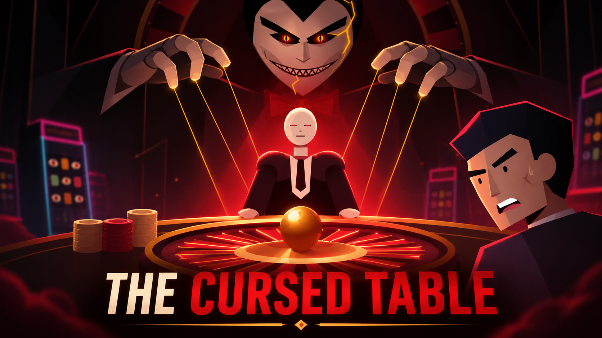
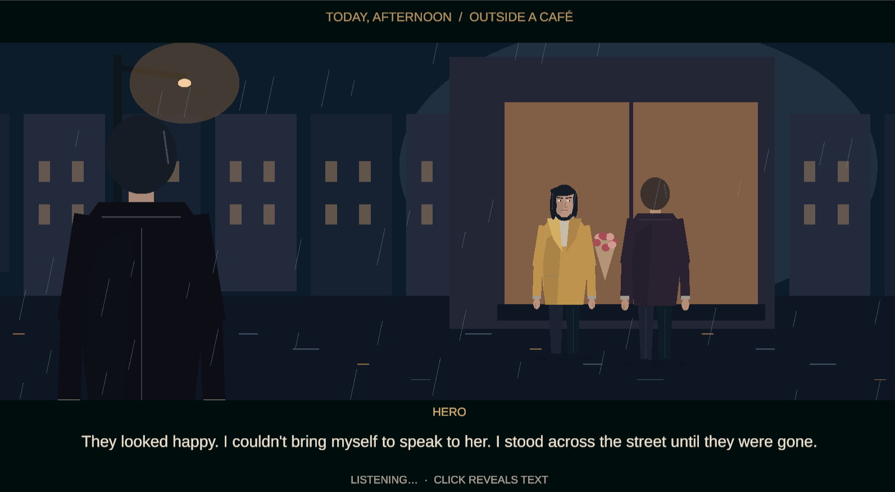
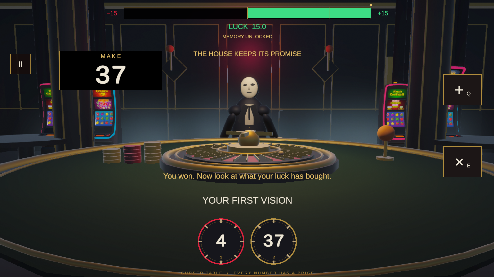
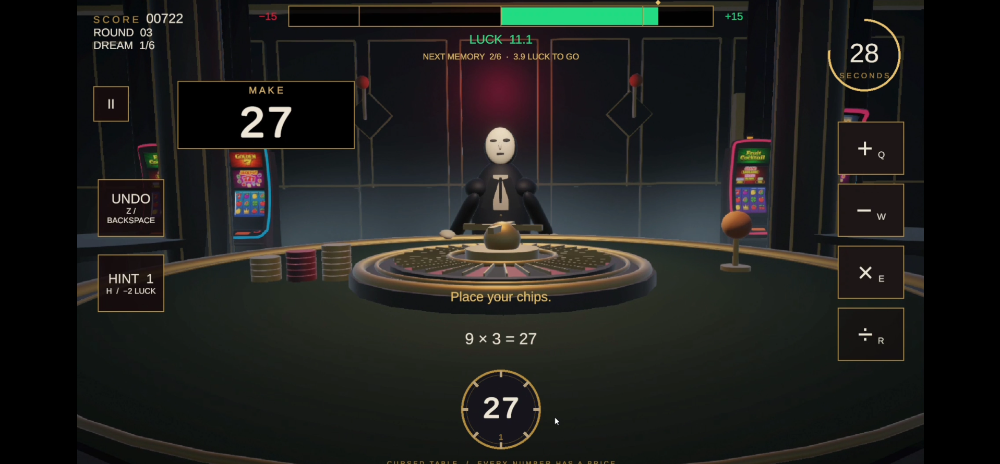
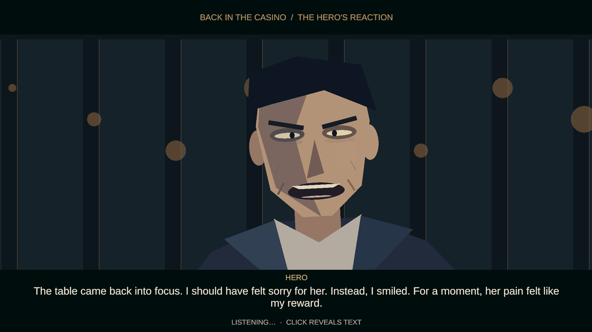

<div align="center">


# THE CURSED TABLE

### *Win a hand. See what she never told you.*

A haunted casino. A masked dealer. A game of numbers where every digit carries luck or a curse.

<br/>

[](https://abhaykrdev.itch.io/the-cursed-table)
[](https://unity.com/)
[](#-play)


[**Play**](#-play) · [**Trailer**](#-trailer) · [**Screenshots**](#-screenshots) · [**How to Play**](#-how-to-play) · [**Run from Source**](#-run-from-source)

</div>

---

## 🎰 About

Three weeks ago, your wife packed a suitcase and walked out. Tonight you stand in the alley behind a casino called **The Hollow Seven**, and a voice behind the door already knows about your wedding ring.

The dealer wears a mask and offers you something better than money: the truth about her new life. All you have to do is play.

**The Cursed Table** is a narrative puzzle game made for the **Official Unity Game Jam 2026**, where the theme was *Lucky Number*. Every hand is a number puzzle. Every number is lucky, cursed, or both. And every win opens a memory you may not want to see.

---

## ▶️ Play

| | |
|---|---|
| 🌐 **In your browser** | [**itch.io page**](https://YOUR-USERNAME.itch.io/the-cursed-table) |
| 🖥️ **From source** | See [Run from Source](#-run-from-source) |

> 🎧 Headphones recommended. Sound starts after your first click.

---

## 🎬 Trailer

<!-- Replace YOUR_VIDEO_ID and the thumbnail path. Clicking the image opens the video. -->
[](https://youtu.be/2Zl-tQBzmrU)

---

## 🖼️ Screenshots

<table>
  <tr>
    <td width="50%"><br/><sub><b>The dealer is expecting you</b></sub></td>
    <td width="50%"><br/><sub><b>Combine chips to hit the target</b></sub></td>
  </tr>
  <tr>
    <td width="50%"><br/><sub><b>Lucky numbers bless you, cursed ones cost you</b></sub></td>
    <td width="50%"><br/><sub><b>Every win opens a memory</b></sub></td>
  </tr>
</table>

---

## 🃏 How to Play

Every hand, the dealer sets a **target number**. You get a handful of numbered chips and a few operators (`+` `−` `×` `÷`). Combine chips, one pair at a time, to reach the target before the clock runs out.

Numbers aren't just numbers here:

| | Examples | Effect |
|---|---|---|
| 🍀 **Lucky** | 7 · 8 · 108 · 777 | Fills your **Luck** meter |
| ☠️ **Cursed** | 4 · 13 · 666 | Drains your **Luck** meter |

The same answer can bless you or cost you, depending on **how** you reach it.

- Fill the meter and the table opens a **memory**.
- Let it hit the bottom and **the house collects**.
- Watch out for **house rules** that change the odds on a hand.

### Controls

| Action | Input |
|---|---|
| Select a chip | **Mouse click** or **1 – 6** |
| Select an operator | **Mouse click** or **Q W E R** (`+ − × ÷`) |
| Undo | **Z** or **Backspace** |
| Hint *(costs Luck)* | **H** |
| Cancel selection / Pause | **Esc** |
| Clear selection | **Right-click** |
| Continue the story | **Space** or **click** |
| Skip the opening | **Hold Space** |
| Mute | **M** |

---

## ✨ Features

- 🎲 **A puzzle about the route, not only the answer.** Lucky and cursed numbers turn every hand into a risk decision.
- 📖 **A six-memory story** that ends in a choice: leave the table, or stay.
- ♾️ **Endless mode** once the story is over, where the curse grows heavier.
- 🏠 **House rules** such as banned operators or doubled curses.
- 📚 **A Codex** that explains why each number is lucky or cursed across different cultures.
- ✅ **Every puzzle is solvable.** Levels are generated and checked by a solver, with difficulty that ramps up over time.
- 🎓 **A short guided first hand** that teaches the rules.
- 🎼 **A soundtrack that reacts to your Luck.**
- 💡 **Hints, undo and a best score** to chase.

---

## 🛠️ Run from Source

**Requirements**

- [Unity](https://unity.com/releases/editor/archive) **6000.6.8f1** (Unity Hub recommended)
- Web Build Support module, if you want to build for the browser

**Steps**

```bash
git clone https://github.com/YOUR-USERNAME/the-cursed-table.git
```

1. Open the project folder in **Unity Hub** and let it import.
2. Import the **ITHappy – Casino Free** asset pack from the Unity Asset Store into `Assets/ithappy/` (it isn't redistributed in this repository).
3. Open `Assets/_Project/Scenes/Game.unity`.
4. Press **Play**.

### Build for the web

1. `File ▸ Build Profiles ▸ Web`.
2. In `Edit ▸ Project Settings ▸ Player ▸ Publishing Settings`, set **Compression Format** to **Gzip** and enable **Decompression Fallback**.
3. Click **Build**, zip the contents of the output folder, and upload it to itch.io as an HTML project.

---

## 🗂️ Project Structure

<details>
<summary>Click to expand</summary>

```text
Assets/_Project/
├── Audio/              Voice lines, music and sound effects
├── Resources/          Runtime-loaded assets
├── Scenes/
│   └── Game.unity      The main (and only) scene
└── Scripts/
    ├── Core/           GameManager, game state, save data
    ├── Puzzle/         LevelGenerator, solver, RoundController, scoring
    ├── Luck/           Luck meter and lucky / cursed number tables
    ├── Story/          Story script, memory panels, dialogue
    ├── Tutorial/       Guided first hand
    ├── Audio/          AudioManager and voice playback
    ├── UI/             HUD and menus
    ├── Input/          Keyboard and mouse routing
    ├── Presentation/   Casino, dealer and camera direction
    └── Editor/         Automated play-through checks
Docs/                   Design notes and test logs
```

</details>

---

## ⚠️ Content Note

The story deals with heartbreak, loneliness and drinking. It includes an implied road accident and a hospital scene. Nothing is shown graphically.

---

## 🙌 Credits

| Role | Name |
|---|---|
| **3D casino props** | [ITHappy – *Casino Free*](https://assetstore.unity.com/) (Unity Asset Store) |
| **Engine** | [Unity](https://unity.com/) |

Made for the **Official Unity Game Jam 2026**. Theme: *Lucky Number*.

---

## 📄 License

© 2026 The Cursed Table team. All rights reserved.
Third-party assets remain the property of their respective owners and are used under their own licenses.

<div align="center">

*The house always collects.*

</div>
